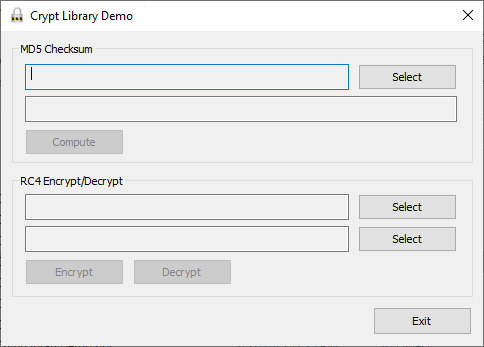

# CryptLibraryDemo

**CryptLibraryDemo** is a Windows desktop application, written in C++ with the Microsoft Foundation Class (MFC) library, that shows how to use the Microsoft `CryptoAPI` to compute checksums (hash codes) and to encrypt and decrypt data. Its reusable part is a small set of functions in `CryptographyExt.h` and `CryptographyExt.cpp` that you can copy into your own MFC project; the dialog only demonstrates them. The project is described in the [Crypt Library Demo](https://www.codeproject.com/articles/Crypt-Library-Demo-The-Basics-of-Microsoft-CryptoA) article on CodeProject.



## Background

In simple terms, cryptography is the application of selected processes for encoding data so that the information can be stored and transmitted securely. The Microsoft `CryptoAPI` allows developers to build cryptographic security into their applications by providing a flexible set of functions to encrypt or digitally sign data. You can use cryptography to achieve many security requirements, including:

- Ensuring secrecy by coding sensitive files so that an interloper cannot understand them;
- Guaranteeing secure communications even though the transmission media is not secure;
- Verifying the origin of messages and data using digital signatures.

The fundamental cryptographic operations supported by the `CryptoAPI` are encryption, decryption, and signing. Encryption is somewhat like controlled fragmentation: the data is there, but it's scattered according to the encryption rules. Decryption is simply the inverse of encryption, where the encryption rules are reversed to reassemble the data. Digital signing is analogous to physically hand-signing a document, but with one significant improvement: it is very, very difficult to forge a digital signature. [Here](https://learn.microsoft.com/en-us/windows/win32/seccrypto/cryptography-portal?redirectedfrom=MSDN) you can find more about this subject.

This project covers checksums, encryption and decryption; it does not implement digital signatures. The `CryptoAPI` is maintained by Microsoft for backward compatibility only: for new development, Microsoft recommends [Cryptography API: Next Generation (CNG)](https://learn.microsoft.com/en-us/windows/win32/seccng/cng-portal).

## Features

- Checksums (hash codes) of a binary buffer, of a `CString` or of a file, computed with MD2, MD4, MD5 or SHA-1; the result is raw bytes for a buffer and uppercase hexadecimal text for a string or a file.
- Encryption and decryption of a binary buffer or of a whole file with a secret key, using RC2, RC4, DES or Triple DES; the demo uses RC4.
- Conversion between binary data and hexadecimal text, also for `CLongBinary` objects.
- `GetComputerID()`, a helper that returns the user name and the computer name as `UserName:ComputerName`; the demo uses it as the secret key.
- `TraceLastError()`, which writes the reason of a failed `CryptoAPI` call to the debug output.
- A dialog that computes the MD5 checksum of a file and encrypts or decrypts a file with RC4.
- Unit tests (the `UnitTests` project) for every function of `CryptographyExt.cpp`, checked against published test vectors and independent implementations.

## The Library

The main implementation is done in _CryptographyExt.h_ and _CryptographyExt.cpp_ files, as follows:

- `bool GetChecksumBuffer(ALG_ID nAlgorithm, LPBYTE lpszOutputBuffer, DWORD& dwOutputLength, LPBYTE lpszInputBuffer, DWORD dwInputLength);` computes the hash code of the given binary buffer, using the specified algorithm; `dwOutputLength` is the size of the output buffer on input and the size of the hash on output;
- `bool GetChecksumString(ALG_ID nAlgorithm, CString& strResult, CString strBuffer);` computes the hash code of the given `CString`, using the specified algorithm, and returns it as hexadecimal text;
- `bool GetChecksumFile(ALG_ID nAlgorithm, CString& strResult, CString strPathName);` computes the hash code of the given file, using the specified algorithm, and returns it as hexadecimal text;
- `bool EncryptBuffer(ALG_ID nAlgorithm, LPBYTE lpszOutputBuffer, DWORD& dwOutputLength, LPBYTE lpszInputBuffer, DWORD dwInputLength, LPBYTE lpszSecretKey, DWORD dwSecretKey);` encrypts the given binary buffer, using the specified algorithm; `dwOutputLength` is the size of the output buffer on input and the size of the ciphertext on output;
- `bool EncryptFile(ALG_ID nAlgorithm, CString strOutputName, CString strInputName, LPBYTE lpszSecretKey, DWORD dwSecretKey);` encrypts the given file, using the specified algorithm;
- `bool DecryptBuffer(ALG_ID nAlgorithm, LPBYTE lpszOutputBuffer, DWORD& dwOutputLength, LPBYTE lpszInputBuffer, DWORD dwInputLength, LPBYTE lpszSecretKey, DWORD dwSecretKey);` decrypts the given binary buffer, using the specified algorithm; `dwOutputLength` returns the size of the plaintext;
- `bool DecryptFile(ALG_ID nAlgorithm, CString strOutputName, CString strInputName, LPBYTE lpszSecretKey, DWORD dwSecretKey);` decrypts the given file, using the specified algorithm;
- Helper function for secret key: `CString GetComputerID();` returns the user name and the computer name as `UserName:ComputerName`;
- `bool ConvertBinaryToHexa(LPTSTR lpszOutputBuffer, DWORD dwOutputLength, LPBYTE lpszInputBuffer, DWORD dwInputLength);` converts binary data to uppercase hexadecimal text; the overload `bool ConvertBinaryToHexa(CLongBinary* pTargetBinary, CLongBinary* pSourceBinary);` does the same for `CLongBinary` objects, allocating the data block of the target with `GlobalAlloc`;
- `bool ConvertHexaToBinary(LPBYTE lpszOutputBuffer, DWORD dwOutputLength, LPCTSTR lpszInputBuffer, DWORD dwInputLength);` converts hexadecimal text back to binary data; the overload `bool ConvertHexaToBinary(CLongBinary* pTargetBinary, CLongBinary* pSourceBinary);` does the same for `CLongBinary` objects, allocating the data block of the target with `GlobalAlloc`;
- `void TraceLastError(LPCTSTR lpszLibrary, LPCTSTR lpszOperation, DWORD dwLastError);` writes the name of a failed operation and the system message for its error code to the debug output.

Every function that returns `bool` returns `false` on failure. The header also defines `CRYPT_LIBRARY_NAME` (the library name that appears in the error traces), `MD5CHECKSUM_LENGTH` and `SHA1CHECKSUM_LENGTH` (the sizes in bytes of an MD5 and of a SHA-1 hash: 16 and 20), `MAX_CRYPT_TAIL` (4096, the room that the file functions add to the output buffer for padding) and `MAX_STR_BUFFER` (4096, the size of the buffer that receives the message of a `CFileException`).

### Usage

Add _CryptographyExt.h_ and _CryptographyExt.cpp_ to an MFC project that has a precompiled header named `stdafx.h`: the `.cpp` file includes it first, and it links `secur32`, `netapi32`, `crypt32` and `advapi32` by itself. The functions can then be used as follows (to keep the example short, it does not check the results):

```cpp
#include "CryptographyExt.h"

// Checksum of a file: strChecksum receives 32 uppercase hexadecimal digits
CString strChecksum;
GetChecksumFile(CALG_MD5, strChecksum, _T("report.pdf"));

// The secret key is any block of bytes; here, the characters of a CString
const CString strSecret = _T("my secret");
LPBYTE lpszSecretKey = (LPBYTE)(LPCTSTR)strSecret;
const DWORD dwSecretKey = (strSecret.GetLength() + 1) * sizeof(TCHAR);

// Files: the output file is created, or overwritten if it already exists
EncryptFile(CALG_RC4, _T("report.enc"), _T("report.pdf"), lpszSecretKey, dwSecretKey);
DecryptFile(CALG_RC4, _T("report.out"), _T("report.enc"), lpszSecretKey, dwSecretKey);

// Buffers: leave room for the padding that block ciphers add
BYTE lpszPlain[] = "Hello, CryptoAPI!";
BYTE lpszCipher[sizeof(lpszPlain) + MAX_CRYPT_TAIL];
DWORD dwCipher = sizeof(lpszCipher); // in: size of the buffer; out: size of the ciphertext
if (EncryptBuffer(CALG_RC2, lpszCipher, dwCipher, lpszPlain, sizeof(lpszPlain), lpszSecretKey, dwSecretKey))
{
	BYTE lpszRestored[sizeof(lpszCipher)];
	DWORD dwRestored = sizeof(lpszRestored); // out: size of the plaintext
	DecryptBuffer(CALG_RC2, lpszRestored, dwRestored, lpszCipher, dwCipher, lpszSecretKey, dwSecretKey);
}
```

## How It Works

- **Provider**: every function acquires the default `PROV_RSA_FULL` cryptographic provider with the `CRYPT_VERIFYCONTEXT` flag, so no persistent key container is used, and releases it before returning.
- **Hashing**: `GetChecksumBuffer` creates a hash object for the requested algorithm, feeds it the data with `CryptHashData` and reads the result with `CryptGetHashParam`. `GetChecksumString` and `GetChecksumFile` call it and convert the hash to uppercase hexadecimal text; their hash buffer has 16 bytes for `CALG_MD5` and 20 bytes for any other algorithm.
- **Key derivation**: `EncryptBuffer` and `DecryptBuffer` hash the secret key with MD5 and give the hash to `CryptDeriveKey`, which creates the session key for the requested algorithm. The same secret always produces the same key.
- **Encryption and decryption**: the input is first copied to the output buffer, which `CryptEncrypt` or `CryptDecrypt` then transforms in place, so the output buffer must be at least as large as the input. Block ciphers (RC2, DES and Triple DES) pad the data to a multiple of the block size, so the ciphertext can be larger than the plaintext; the file functions reserve `MAX_CRYPT_TAIL` extra bytes for that. RC4 is a stream cipher: its ciphertext is as large as the plaintext, and applying it twice with the same key restores the data.
- **Files**: `GetChecksumFile`, `EncryptFile` and `DecryptFile` read the whole input file into memory. `EncryptFile` and `DecryptFile` then create the output file, or overwrite it if it already exists.
- **Errors**: when a `CryptoAPI` call fails, `TraceLastError` writes `[Crypt] <operation>: <message>` to the debug output (for example, to the **Output** window of Visual Studio) and the function returns `false`. A file exception is also written to the debug output.

## Limitations

This is a demonstration project, and it has these limits:

- **Algorithms**: the `PROV_RSA_FULL` provider offers the MD2, MD4, MD5 and SHA-1 hashes and the RC2, RC4, DES and Triple DES ciphers. SHA-2 hashes and AES ciphers are not available: the functions return `false` (for example, `CryptCreateHash` fails with `NTE_BAD_ALGID` for SHA-256). Supporting them would require changes in the library, such as the `PROV_RSA_AES` provider and larger hash buffers.
- **Strength**: all the available algorithms are obsolete or deprecated by today's standards. The session key comes from a single unsalted MD5 hash of the secret, and the encrypted data has no integrity check: decrypting with a wrong RC4 key still succeeds and produces garbage. Use [CNG](https://learn.microsoft.com/en-us/windows/win32/seccng/cng-portal) for new work.
- **String checksums**: `GetChecksumString` hashes the UTF-16 characters of the string, including the terminating null character, so it does not return the usual checksum of the text: for `abc` the MD5 is `0325B2BC5BC6ECFBAC751818498ECE3F`, not `900150983CD24FB0D6963F7D28E17F72`. To checksum text in another encoding, convert it and call `GetChecksumBuffer` with the converted bytes.
- **Files**: they are read completely into memory, so they must fit in memory and be smaller than 4 GB. An empty or missing input file makes the function return `false`.
- **Hexadecimal helpers**: `ConvertBinaryToHexa` writes a terminating null character, so its output buffer needs `2 * n + 1` characters for `n` bytes; `ConvertHexaToBinary` accepts only uppercase digits (`0`-`9` and `A`-`F`).
- **Demo key**: the dialog uses `GetComputerID()` as the secret, so a file can be decrypted only under the same user name and computer name. The names are not secret: this ties a file to a user and a computer, but does not protect it from anyone who knows them. In Debug builds, `GetComputerID()` also writes both names to the debug output.
- **Demo decryption**: both **Encrypt** and **Decrypt** call `EncryptFile` with `CALG_RC4`, which works only because RC4 is symmetric. To decrypt a file encrypted with a block cipher, call `DecryptFile`.
- **Demo messages**: the dialog reports only successes; a failure appears in the debug output only.

## Getting Started

### Prerequisites

- Windows and Visual Studio 2026 (the project uses the MSVC v145 toolset).
- The **Desktop development with C++** workload, including the C++ MFC component for the latest MSVC build tools (x86 and x64): the project links MFC statically.
- A Windows 10 or Windows 11 SDK.
- [HTML Help Workshop](https://learn.microsoft.com/en-us/previous-versions/windows/desktop/htmlhelp/microsoft-html-help-downloads) (`hhc.exe`), which the build uses to compile the help file `hlp\CryptLibraryDemo.hhp`.

### Building the Project

1. Clone the repository:

   ```bash
   git clone https://github.com/mihaimoga/CryptLibraryDemo.git
   ```

2. Open `CryptLibraryDemo.sln` in Visual Studio.
3. Select the **Debug** or **Release** configuration and the **x64** or **Win32** platform, then choose **Build > Build Solution**. To build from a Developer PowerShell for Visual Studio instead, run:

   ```powershell
   msbuild CryptLibraryDemo.vcxproj /p:Configuration=Release /p:Platform=x64
   ```

The executable and the help file `CryptLibraryDemo.chm` are written to `x64\Release` for the x64 platform and to `Release` for Win32; the Debug configuration uses `x64\Debug` and `Debug`. The build also regenerates `hlp\HTMLDefines.h` from `resource.h`. The solution also contains the `UnitTests` project, which **Build Solution** builds as well (see Running the Tests).

### Running

1. Start `CryptLibraryDemo.exe` from the output folder, next to `CryptLibraryDemo.chm`.
2. In the **MD5 Checksum** group, click **Select** to choose a file, then click **Compute**: the MD5 checksum of the file appears in the checksum box and a message confirms it.
3. In the **RC4 Encrypt/Decrypt** group, click the first **Select** to choose the input file and the second **Select** to choose the output file, then click **Encrypt** or **Decrypt**. A message appears when the operation succeeds. If the output file already exists, it is overwritten without confirmation.
4. Open the system menu (click the icon at the left end of the title bar, or press Alt+Space) to see the **About ...** box and the links to the author's social profiles and to the Issues, Discussions and Wiki pages of this project.

The functions in `CryptographyExt.cpp` also have unit tests; see Running the Tests below. Changes to the dialog still have to be validated by running the application.

### Running the Tests

The `UnitTests` project, which is part of the solution, tests every function of `CryptographyExt.cpp` without the dialog: the checksums of buffers, strings and files, the encryption and decryption of buffers and files with every cipher, the hexadecimal converters, `GetComputerID` and `TraceLastError`. It uses the Microsoft Unit Testing Framework for C++, which comes with the **Desktop development with C++** workload, and it compiles `CryptographyExt.cpp` itself, so the application does not have to be built first.

1. In Visual Studio, build the **UnitTests** project (right-click it in Solution Explorer and choose **Build**), then choose **Test > Run All Tests**. The results appear in **Test Explorer**.
2. To run the tests from a Developer PowerShell for Visual Studio instead, build the test project alone and run it with `vstest.console.exe`:

   ```powershell
   msbuild UnitTests\UnitTests.vcxproj /p:Configuration=Debug /p:Platform=x64
   vstest.console.exe UnitTests\x64\Debug\UnitTests.dll /Platform:x64
   ```

   For Win32, build with `/p:Platform=Win32`, then run `UnitTests\Win32\Debug\UnitTests.dll` with `/Platform:x86`. The Release configuration works in the same way and writes to `UnitTests\x64\Release` and `UnitTests\Win32\Release`.

The expected values do not come from the code under test: they are published test vectors (RFC 1319, RFC 1320, RFC 1321 and FIPS 180) and the results of independent implementations (the Windows CNG API, a small software RC4 and the PyCryptodome library). The tests that read the debug output of the library skip themselves while a debugger is attached, and the tests that detect a failed `ASSERT` or `VERIFY` of the library work only in the Debug configuration.

### API Documentation

The public functions are documented with Doxygen comments. To generate the HTML documentation, install [Doxygen](https://www.doxygen.nl/) and run `!doxygen.bat` from the repository folder: it deletes the previous contents of the `html` folder and runs `doxygen doxyfile.txt`.

## File Structure

- `CryptographyExt.h`, `CryptographyExt.cpp`: the reusable cryptographic functions (checksums, encryption, decryption, conversions and error tracing);
- `CryptLibraryDemo.h`, `CryptLibraryDemo.cpp`: the MFC application class `CCryptLibraryDemoApp`;
- `CryptLibraryDemoDlg.h`, `CryptLibraryDemoDlg.cpp`: the main dialog `CCryptLibraryDemoDlg` and the About box;
- `HLinkCtrl.h`, `HLinkCtrl.cpp`: the `CHLinkCtrl` hyperlink control by PJ Naughter, used by the About box;
- `VersionInfo.h`, `VersionInfo.cpp`: the `CVersionInfo` class by PJ Naughter, used by the About box to read the version of the application;
- `resource.h`, `CryptLibraryDemo.rc`, `res/`: the resource identifiers, the resource script and the resource files (the icon and the `.rc2` file);
- `stdafx.h`, `stdafx.cpp`, `targetver.h`: the precompiled header and the target Windows version;
- `hlp/`: the HTML Help project that is compiled into `CryptLibraryDemo.chm`; `HTMLDefines.h` is generated by the build, so do not edit it by hand;
- `CryptLibraryDemo.sln`, `CryptLibraryDemo.vcxproj`, `CryptLibraryDemo.vcxproj.filters`: the Visual Studio solution and project;
- `UnitTests/`: the project `UnitTests.vcxproj` with the unit tests of `CryptographyExt.cpp` and their helpers;
- `doxyfile.txt`, `!doxygen.bat`: the Doxygen configuration and the script that regenerates the API documentation;
- `CryptLibraryDemo.png`: the screenshot shown above;
- `CryptLibraryDemo.html`: the same content as `README.md`, as a standalone HTML help page;
- `ReleaseNotes.html`, `SoftwareContentRegister.html`: the release notes and the register of the third-party components;
- `AGENTS.md`: the repository conventions for contributors and coding agents.

## Roadmap

The work below is still open. It follows from the limits listed under Limitations, and no release dates are set.

- **Offer every algorithm in the dialog.** The dialog uses only MD5 and RC4, although the library also offers the MD2, MD4 and SHA-1 hashes and the RC2, DES and Triple DES ciphers. Two lists of algorithms, one for the checksum and one for the encryption, would show them all. First, `OnBnClickedDecrypt` has to call `DecryptFile`: it calls `EncryptFile` with `CALG_RC4` now, which works only because RC4 is symmetric.
- **Report failures in the dialog.** The handlers of the **Compute**, **Encrypt** and **Decrypt** buttons show a message only when the call succeeds, and the library functions return just `bool`, so the dialog cannot tell why a call failed: a CryptoAPI error or a file error goes to the debug output, and an empty input file is not reported at all. If the functions also returned the reason, for instance in an extra parameter, the dialog could say what went wrong: the input file is empty, another program has a file open, or the output file cannot be written.
- **Ask for a password.** The secret of the dialog is `GetComputerID()`, the user name and the computer name: a file can be opened only under the same names, and anyone who knows them can open it. A password box would let the user choose the secret. The `TRACE` calls in `GetComputerID()` that write both names to the debug output in Debug builds can be removed at once, because `AGENTS.md` asks not to log keys.
- **Run the tests on every pull request.** The `UnitTests` project tests the library, but nothing runs it for a pull request: the `.github` folder has no workflow yet. A GitHub Actions workflow could build `UnitTests\UnitTests.vcxproj` for the x64 and Win32 platforms and run the tests with `vstest.console.exe`, so that a change that breaks the library is found before it is merged.
- **Support SHA-2 and AES.** The functions acquire the `PROV_RSA_FULL` provider, which has neither. The `PROV_RSA_AES` provider offers the SHA-256, SHA-384 and SHA-512 hashes and the AES-128, AES-192 and AES-256 ciphers, and it produces the same ciphertext as the present provider for RC2, RC4, DES and Triple DES, so the files that the present version wrote stay readable. The hash buffer of `GetChecksumString` and `GetChecksumFile` (16 bytes for MD5, 20 bytes for any other algorithm) would have to follow the size of the hash, because SHA-2 needs 32, 48 or 64 bytes.
- **Process large files in blocks.** `GetChecksumFile`, `EncryptFile` and `DecryptFile` read the whole file into memory (the last two also allocate a second buffer of the same size plus `MAX_CRYPT_TAIL` bytes) and cast its length to `UINT`, so a file must fit in memory and be smaller than 4 GB. Both limits would go away if the data were processed in blocks: `CryptHashData` can be called once per block, and `CryptEncrypt` and `CryptDecrypt` take a `Final` flag for the last block. With blocks that are a multiple of the cipher block size, the hash and the ciphertext are the same as with a single call, so existing files are not affected.
- **Protect the encrypted data better.** The key comes from a single unsalted MD5 hash of the secret and no IV is set, so the same secret always gives the same key: RC4 encrypts every file with the same keystream, and the block ciphers give the same ciphertext for the same data. Nothing checks that the data is intact either, so decrypting with a wrong RC4 key just produces garbage. A random salt and IV for each file, a slow key derivation function and an integrity check (a MAC, or an authenticated mode), stored in a small header with a version number so that older files can still be read, would remove these weaknesses. CNG provides `BCryptDeriveKeyPBKDF2` and AES in GCM mode for this.

Every item on this roadmap is open to discussion and to contributions. Open an [issue](https://github.com/mihaimoga/CryptLibraryDemo/issues) that names the item before you start working on it, so that the administrators and the community can talk it over with you; an issue for an enhancement has to be approved by an administrator, and an approved issue gets the `Accepted` label. Ideas that are not on the list are welcome in the [Discussions](https://github.com/mihaimoga/CryptLibraryDemo/discussions).

## Contributing

Bug reports and pull requests are welcome; please read [CONTRIBUTING.md](CONTRIBUTING.md) first, because most pull requests need an approved issue. This project follows the [Code of Conduct](CODE_OF_CONDUCT.md). Please report security vulnerabilities privately, as described in [SECURITY.md](SECURITY.md). The repository conventions (formatting, build and validation) are summarized in [AGENTS.md](AGENTS.md). If a change touches `CryptographyExt.cpp`, run the unit tests in the Debug and Release configurations before you open a pull request (see Running the Tests).

## License

CryptLibraryDemo is licensed under the GNU General Public License, version 3 or (at your option) any later version - see the [LICENSE](LICENSE) file for details. The third-party components used by the project have their own licenses, listed in [SoftwareContentRegister.html](SoftwareContentRegister.html).

Created by [Stefan-Mihai MOGA](https://www.moga.doctor/).
